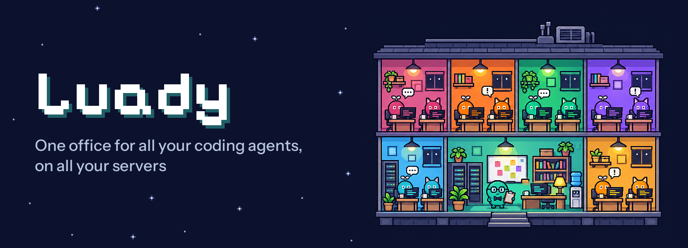
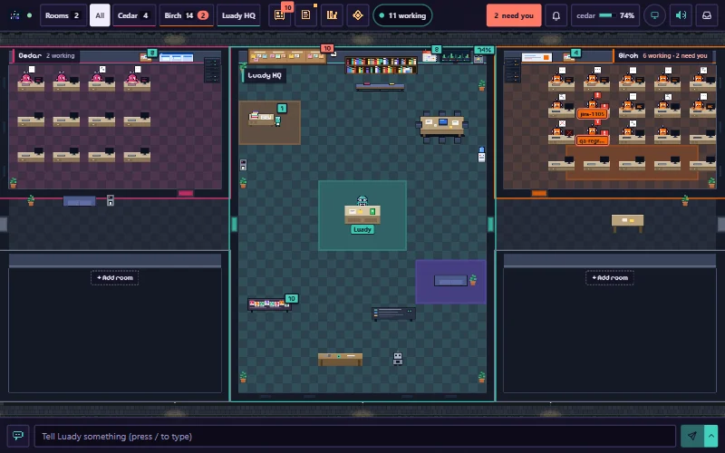
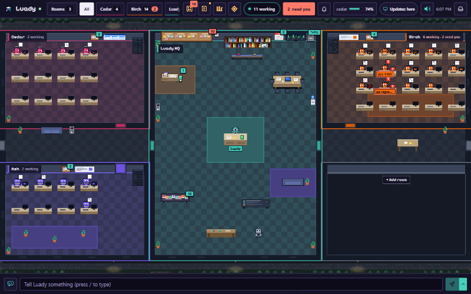
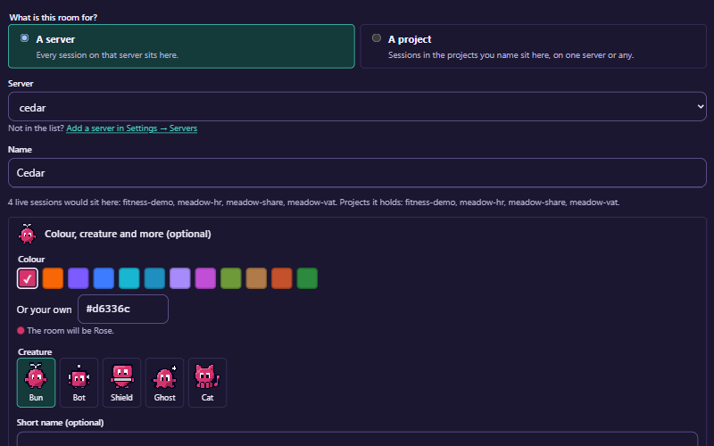
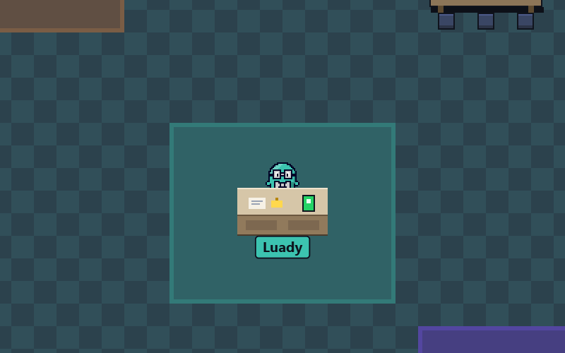
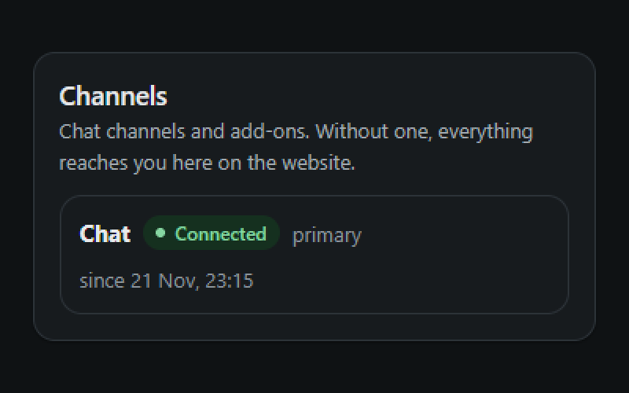
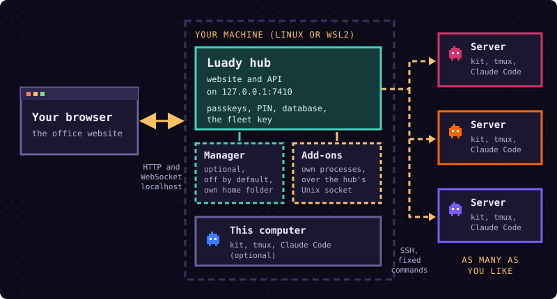

<p align="center">
  <a href="https://www.baraaalshugri.info/luady/demo/">
    
  </a>
</p>

<p align="center">
  <strong>A self-hosted, pixel-art office for your Claude Code sessions, on all your servers.</strong><br>
  For developers who run Claude Code on more than one machine and want to see and steer it all from one browser tab.
</p>

<p align="center">
  <a href="LICENSE"></a>
  <a href="https://github.com/bv4ts/luady/actions/workflows/ci.yml"></a>
  <a href="#run-it-for-real"></a>
  <a href="https://github.com/bv4ts/luady/releases"></a>
  <a href="https://www.baraaalshugri.info/luady/docs.html"></a>
</p>

<p align="center">
  <a href="https://www.baraaalshugri.info/luady/">Website</a> ·
  <a href="https://www.baraaalshugri.info/luady/demo/"><strong>Live demo</strong></a> ·
  <a href="#try-it">Try it</a> ·
  <a href="#run-it-for-real">Install</a> ·
  <a href="https://www.baraaalshugri.info/luady/docs.html">Docs</a> ·
  <a href="CONTRIBUTING.md">Contributing</a>
</p>

<p align="center">
  <picture>
    <source media="(prefers-reduced-motion: reduce)" srcset="docs/assets/office.png">
    
  </picture>
  <br>
  <sub>The real website against a pretend fleet: a room is added for the server <code>ash</code>, then the camera moves between rooms.</sub>
</p>

## What it is

Luady runs on a machine of yours, the hub machine, and reaches your servers over SSH. In the browser you get an office:

- Each **server or project is a room**. Each **Claude Code session is a creature at a desk**, with a bubble that says
  whether it is working, idle or waiting for you.
- Click a session to see its recent steps and its to-do list, send it a message, or pause it. When a session asks a
  question or wants permission for a tool, you answer on the website.
- Start new sessions from the website. Keep a board, notes, a library of skills and your Jira next to the map.

## Try it

Open the **[live demo](https://www.baraaalshugri.info/luady/demo/)**: the office page with a pretend hub inside your browser.
Nothing to install, and the page loads nothing from anywhere else. It is only the office page: no sign-in, no setup,
and its servers are pretend. Rooms you add or change are gone when you reload.

Or run the demo on your computer. It is the real hub with a pretend fleet; nothing real is contacted. It runs on
Windows and Linux, and has not been tried on macOS yet.

```sh
git clone https://github.com/bv4ts/luady.git && cd luady
npm ci
npm run demo
```

The first run builds what it needs. Open the login link it prints, in Chrome or Firefox. The demo PIN is `123456`.
Stop it with <kbd>Ctrl</kbd>+<kbd>C</kbd>. For a bigger office, run `npm run demo -- --rooms 24` (in PowerShell:
`npm run demo '--' --rooms 24`). More options are in [the quickstart](docs/quickstart.md#demo-options).

## Run it for real

You need Linux or Windows with WSL2 for the hub, and [Node.js](https://nodejs.org/) 22.12 or newer. Each server needs
Linux, SSH, Python 3.10 or newer, tmux, tar, mktemp and Claude Code.

```sh
git clone https://github.com/bv4ts/luady.git && cd luady
npm ci
npm run build
npm start
```

`npm start` prints a one-time setup code in the terminal. Open <http://localhost:7410> and follow the setup wizard:

1. **Claim** the hub with the setup code from the terminal, and create a passkey.
2. **Choose a PIN** for risky actions.
3. **Rooms.** Add this computer or a server, and a room for each. For a server, paste one line on it, compare its
   fingerprint, and the hub installs the kit for you.
4. **Connect.** Check each machine's kit and sign in to Claude on it.
5. **Extras.** The manager, nightly jobs and chat channels, all off unless you switch them on.
6. **Open the office.** You can skip steps 3 to 5 and come back to them in Settings.

Step by step: [Quickstart](docs/quickstart.md) · [Getting started](docs/getting-started.md) ·
[The setup wizard](docs/setup-wizard.md) · [Adding servers](docs/servers.md).

## What makes it different

<table>
  <tr>
    <td width="50%" valign="top">
      
      <p><strong>Several servers in one place.</strong> Every machine you reach over SSH, and this computer, in one
      office. Add a server from the website: paste one line on it, confirm its fingerprint, and the kit is installed
      for you.</p>
    </td>
    <td width="50%" valign="top">
      
      <p><strong>A room for each server or project.</strong> As many rooms as you like. Name them, colour them, pick a
      creature, reorder them. A project room gathers the sessions of the projects you name, from any server.</p>
    </td>
  </tr>
  <tr>
    <td width="50%" valign="top">
      
      <p><strong>An optional manager.</strong> A Claude Code agent of its own, at HQ, that you talk to in plain words.
      It can start, stop and message your sessions. Off until you switch it on, and kept to its own folder.</p>
    </td>
    <td width="50%" valign="top">
      
      <p><strong>Add-ons.</strong> Chat channels, and extra tools for the manager, run as their own programs and speak a
      small documented protocol. The <a href="packages/addon-sdk">SDK</a> comes with a working example.</p>
    </td>
  </tr>
</table>

## How it works

<p align="center">
  
</p>

- **The hub** is one Node.js process on the hub machine, the computer you install it on. It serves the website on
  `127.0.0.1:7410`, keeps its state in SQLite, and pushes live changes to the browser over a WebSocket.
- **The kit** is a small Python program on each server (and on this computer). Claude Code hooks write down what each
  session does and pass its questions to the hub. Sessions run in tmux. What leaves the server includes short previews
  of your prompts and of Claude's messages; a redactor first replaces common secret shapes with `[redacted]`. That is a
  best effort, not a guarantee. When you open a session, the hub also reads its whole transcript from the server.
- **SSH** links the hub to each server with its own key, the fleet key. The commands the hub builds there come from a
  fixed list: the kit's verbs and three setup scripts.
- **The manager and add-ons** run next to the hub, on the hub machine, each as its own process.

More in [the docs](https://www.baraaalshugri.info/luady/docs.html).

## Security

- The hub listens on `127.0.0.1` and answers only to `localhost`. Reaching it from elsewhere goes through an SSH tunnel.
- You sign in with a passkey (or, on the hub machine or through an SSH tunnel to it, a login link from the command
  line), and every request also carries a page key that other local programs cannot borrow.
- Risky actions, such as stopping a session, adding a server or writing a file on one, ask for your PIN. Starting a
  session and sending it a message do not.
- The hub reaches your servers with a key that cannot forward anything, and builds its own commands there from a fixed
  list. What you or the manager type goes to a server through your terminal or the manager's command action, and a
  command that is not read-only waits for your PIN.
- The manager is off by default. Switched on, it acts with the rights of the user on each of your hosts, and your PIN is a
  brake on its risky actions only: [docs/manager.md](docs/manager.md#what-it-can-do) lists them.

> [!WARNING]
> Sessions started from Luady run Claude Code with its permission prompts bypassed, so give each server a user that may only touch what those sessions should.

To report a vulnerability, see [SECURITY.md](SECURITY.md). The details are in
[docs/security-notes.md](docs/security-notes.md) and [docs/security.md](docs/security.md).

## Not yet

This is an early version. It does not have:

- a chat app built in (channels come as add-ons);
- a Docker image or a one-line installer;
- the hub on macOS (the hub runs on Linux or WSL2; servers are Linux);
- agents other than Claude Code;
- themes, or languages other than English;
- phone notifications, a usage page, more than one person per hub, or an update button.

## Contributing

Bug reports, fixes, docs and add-ons are welcome. Please read [CONTRIBUTING.md](CONTRIBUTING.md) first.

```sh
npm ci
npm run build
npm test
npm run typecheck
```

The docs site is built from [`docs/`](docs/) with `npm ci --prefix site && npm run build --prefix site`.

## Licence

Luady is licensed under the [Apache License 2.0](LICENSE). Copyright The Luady Authors. See also [NOTICE](NOTICE).

The docs site uses the Pixelify Sans font, under the SIL Open Font License ([its licence](site/fonts/pixelify-sans/OFL.txt)).

Luady is not affiliated with Anthropic. "Claude" and "Claude Code" are Anthropic's names.
