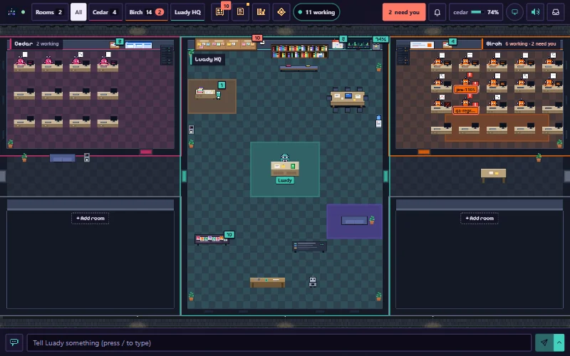

# Luady documentation

Luady is a self-hosted website for people who run Claude Code on more than one machine. It shows every session on
every server as a pixel-art office in your browser, and you steer the sessions from there.

<picture>
  <source media="(prefers-reduced-motion: reduce)" srcset="assets/office.png">
  
</picture>

The real website, running against a pretend fleet: nothing in this picture is a real server.

## What you get

- **One room for each server or project.** Add as many rooms as you like. A server room holds every session on that
  server; a project room holds the sessions of the projects you name, on one server or on any.
- **A creature at a desk for each session.** Its bubble says whether it is working, idle or waiting for you. Click it
  to see its recent steps and its to-do list, send it a message, or pause it.
- **Questions come to you.** When a session asks a question or wants permission for a tool, you answer on the website.
- **An optional manager.** A Claude Code agent of its own, in the middle of the office, that you can talk to. It is off
  until you switch it on.
- **Add-ons.** Small separate programs that connect a chat channel or give the manager extra tools, through a
  documented protocol and a small SDK.

## How it works

- **The hub** is one Node.js process on the hub machine, the computer you install it on. It serves the website on
  `127.0.0.1:7410`, keeps its state in SQLite, and pushes live changes to the browser over a WebSocket.
- **The kit** is a small Python program on each server, and on this computer if you add it. Claude Code hooks write
  down what each session does and pass its questions to the hub. What leaves the server includes short previews of
  your prompts and of Claude's messages; a redactor first replaces common secret shapes with `[redacted]`. That is a
  best effort, not a guarantee. When you open a session, the hub also reads its whole transcript from the server.
- **SSH** links the hub to each server with its own key, the fleet key. The commands the hub builds there come from a
  fixed list: the kit's verbs and three setup scripts.
- **The manager and add-ons**, when you use them, run next to the hub as processes of their own.

## Where to start

| If you want to | Read |
|---|---|
| See it without installing anything | The [live demo](https://www.baraaalshugri.info/luady/demo/): only the office page, with pretend data |
| Try it on your computer with pretend servers | [Try the demo](getting-started.md#try-the-demo) |
| Install it and connect your servers | [Getting started](getting-started.md), then [the setup wizard](setup-wizard.md) |
| Install on a fresh Linux or WSL2 machine, command by command | [Quickstart](quickstart.md) |
| Arrange the office | [Rooms](rooms.md) |
| Connect a server, or this computer | [Adding servers](servers.md) |
| Talk to the manager | [The manager](manager.md) |
| Connect a chat app or a tool | [Add-ons and the SDK](addons.md) |
| Look up a setting in `config.json` | [The config file](configuration.md) |
| Know what it can and cannot touch | [Security](security.md) |
| Fix something | [Troubleshooting and doctor](troubleshooting.md), [FAQ](faq.md) |

## What this version does not do yet

Luady is young. Some things people ask for are not in this version:

- a chat app built in (chat channels come as [add-ons](addons.md));
- a Docker image or a one-line installer;
- the hub on macOS (the hub runs on Linux or on Windows with WSL2; servers are Linux);
- agents other than Claude Code;
- themes, or languages other than English;
- phone notifications, a usage page, more than one person, or an update button.

## About these docs

These pages live in the [`docs/` folder](./) of the repository and are built into the docs site by
[`site/build.mjs`](../site/build.mjs). Corrections are welcome: see [CONTRIBUTING.md](../CONTRIBUTING.md).

Luady is not affiliated with Anthropic. "Claude" and "Claude Code" are Anthropic's names.
