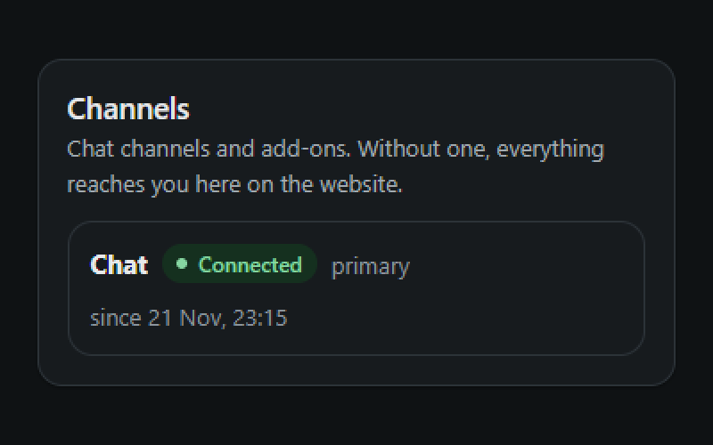

# Add-ons and the SDK

Luady has no chat app built in. An **add-on** is a small program of its own that connects to the hub and adds
something:

- a **channel**: a chat app you talk to Luady through. The hub sends you messages there, and your messages reach the
  manager;
- **tools**: things the [manager](manager.md) can do, such as looking something up in a service you use.

One add-on can be both. Without any channel, everything reaches you on the website.



<p class="caption"><sub>The Channels section with one channel add-on connected (a stand-in channel from the developer preview, <code>npm run preview</code>).</sub></p>

## How an add-on connects

An add-on runs as its own process on the hub machine and speaks **Add-on Protocol v1**: JSON messages over a WebSocket
on the hub's Unix socket (`~/.local/share/luady/run/hub.sock`). It can be written in any language. For JavaScript and
TypeScript there is a small client, the SDK, in [`packages/addon-sdk`](../packages/addon-sdk/), with a complete example.

The protocol, message by message, is in the SDK's [README](../packages/addon-sdk/README.md#the-protocol-in-short).

## Set one up

1. **Declare it** in `~/.config/luady/config.json`:

   ```json
   {
     "addons": [{
       "id": "echo", "kind": "channel", "name": "Echo (terminal)",
       "owner": "me", "primary": true
     }]
   }
   ```

   - `id`: 2 to 24 characters, lower-case letters, digits and `-`, starting with a letter. A few words belong to the hub
     (`web`, `phone`, `event`, `scheduled`, `remote_control`, `chat`, `manager`, `hub`).
   - `kind`: `channel` or `tools`.
   - `owner` (channels only): your address in that chat app. Messages from anyone else are dropped.
   - `primary`: the channel the hub uses to reach you. At most one.
2. **Start the hub** once. It writes the add-on's token to `~/.local/share/luady/data/addons/<id>.token` (mode 0600)
   and makes a folder for the files the add-on hands over.
3. **Start the add-on**, giving it the hub socket and its token file.

## Try the example

The SDK ships an example channel, **echo**: a terminal. Each line you type is a message from you to the hub, and the
hub's answers are printed. It also offers the manager one tool, `echo_back`, and shows a panel with one button in
**Settings → Channels**.

With the add-on declared as above and the hub started once:

```sh
npm run build
LUADY_HUB_SOCKET=~/.local/share/luady/run/hub.sock \
LUADY_ADDON_TOKEN_FILE=~/.local/share/luady/data/addons/echo.token \
node packages/addon-sdk/dist/examples/echo-main.js
```

Copy [`echo.ts`](../packages/addon-sdk/src/examples/echo.ts) to start your own.

## Write your own

The SDK is not published on npm: the [SDK's readme](../packages/addon-sdk/README.md) shows how to install it in your
own project from a clone of this repository.

```ts
import { createAddonClient, readAddonToken } from '@luady/addon-sdk';

const client = createAddonClient({
  id: 'mychat',
  token: await readAddonToken('/path/to/data/addons/mychat.token'),
  socketPath: '/path/to/run/hub.sock',
  hello: { kind: 'channel', version: '1.0.0',
    capabilities: { /* what your chat app can do */ } },
  handlers: {
    onConnected: () => client.status('up', null),
    onSend: async (frame) => {
      const id = await myChat.send(frame.text, frame.replyTo);
      client.sent(frame.ref, id, null);
    },
  },
});
client.start();
myChat.onMessage((m) =>
  client.incoming({ msgId: m.id, from: m.sender, text: m.text, ts: m.time }));
```

The client reconnects by itself, keeps what it could not send while the hub was away, and checks every message against
the shared schemas both ways.

## What an add-on can and cannot do

It can:

- carry your messages in both directions (a channel), saying which features its chat app has (files, edits, typing and
  so on); the hub uses only those;
- show a **panel** in **Settings → Channels**: text, a QR code, a code to copy, an input and buttons. A panel is data,
  never code: every string is shown as plain text;
- offer the manager up to 20 **tools**, and a short note the manager reads;
- hand you a file or a text, on your chat channel or, without one, on the website.

It cannot:

- use another add-on's connection, or see its messages;
- use its token anywhere but its own route: the website's API and the manager's tool API refuse it;
- run code in your browser;
- hand over a file from outside its own folder;
- take the name of one of the hub's own tools.

## What you trust an add-on with

> [!WARNING]
> An add-on runs on the hub machine as the same Unix user as the hub. Its token tells the hub **which** add-on is talking;
> it does not fence the add-on in. That user can read the hub's database, its secrets and the fleet key. A channel
> add-on speaks as you, and sees what you type in that chat, a PIN included. **Install only add-ons you would run as
> yourself.**

More detail: [Security notes, add-ons](security-notes.md#what-an-add-on-is-trusted-with).
