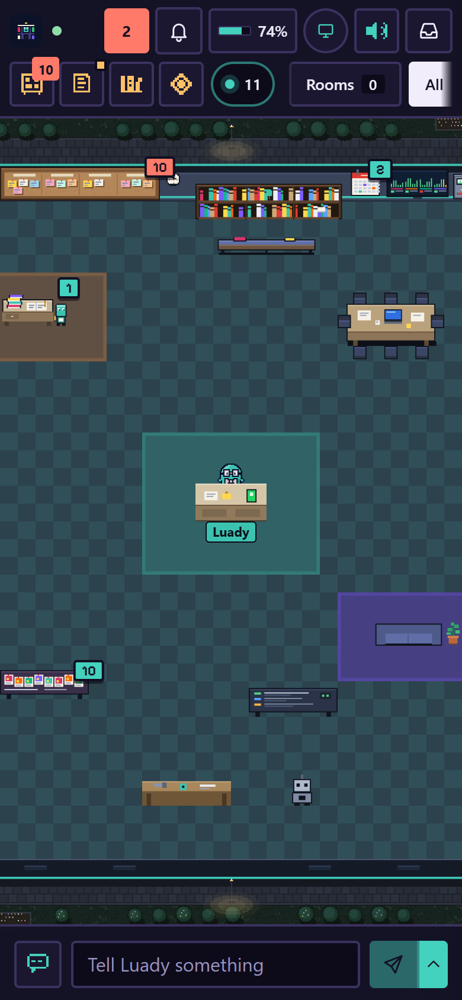

# The manager

The manager is an optional agent that lives in the middle of the office, at HQ. It is Claude Code, running on the hub
machine, with tools to see and steer your rooms. You talk to it in plain words; it answers, and acts when you ask.

It is **off** on a new hub. Nothing about it runs until you switch it on.

## What it can do

When it is on, the manager acts through the hub's tools on your servers and, if you added it, on this computer (the
machine the hub runs on). **Switching it on gives it the rights of the Unix user each of those hosts uses, with your PIN
as a brake on the actions listed under "With your PIN".** On this computer that user is the hub's own.

It uses your Claude plan, with the strongest model at high effort by default. It also gets a list of your rooms, and any
tools your [add-ons](addons.md) offer it.

### Without your PIN

- It reads the hub's state (servers, rooms, sessions, questions, actions, plan limits, its schedules) and the recent
  transcript of any of your sessions.
- It starts a session, types into one, or answers a session's question (an answer is free text the session follows)
  only while it is answering a message from you (on the website, the phone or a chat app) or a **Run** or **Give to…**
  you pressed on the board on the website. That standing ends when the turn stops, and also on a restart, `/reset`,
  switching the manager off, a crash, or when the manager waits for input. A prompt that joins a turn with nothing
  new for five minutes (one you may have interrupted in the Claude app) gets none of that turn's standing, only its
  own. It interrupts, pauses and resumes sessions at any time; a pause you set only you can lift.
- It hands questions and permission requests back to the terminal. It never answers a permission request.
- It runs a command when the hub judges it read-only: a short fixed list of programs such as `ls`, `cat`, `grep`, `df`
  and `git status`. On this computer no command counts as read-only.
- It reads up to 200 kB of any file, and sends you any file up to 50 MB. A short list of places is refused: SSH key
  folders, Claude sign-in files, `/etc/shadow`, `/etc/gshadow`, `/etc/sudoers` and the kit's answer files. On this
  computer its file tools (reading, sending and writing files) are also refused the hub's own folders, with or
  without the PIN: the config folder, the secrets file, the data and run folders (the hub's ChatGPT sign-in for
  pictures is in the data folder), the manager's home, the hub token, the fleet key, the manager's own settings in
  its folder (`.manager/`), `~/.codex` and the `.codex` folder beside the data folder (where older releases kept the
  ChatGPT sign-in). Writing there is refused in the local kit (`~/.luady`) and the folder Luady is installed in as
  well. This binds the file tools only: a command you approve on this computer, and a session there, can read and
  write those folders, and the picture tool's Codex agent can read them.
- It copies any file in its inbox folder to `~/luady-inbox/` on a host: a file you sent it, or one it put there
  itself.
- It messages and calls you, keeps your board, schedules reminders to itself, and writes knowledge-base pages, which
  your servers get a copy of. Each page it writes leaves a row in the action log, and it never replaces a page you wrote
  or pinned (see [The knowledge base and the code map](#the-knowledge-base-and-the-code-map)).
- It reads mail and calendar and your Wispr Flow meetings, and comments on and moves Jira tickets, only if you
  connected them. It searches the web (it cannot open a page itself).
- It makes pictures with the Codex CLI on the hub machine. Codex is an agent: it runs read-only and with a Codex home
  of the hub's own in its data folder (never your `~/.codex`), but it can read any file the hub's user can, and the
  manager writes its prompt.

### With your PIN

**Ask for my PIN before the manager's risky actions** is on by default. While it is on, these wait for your PIN:

- starting a session, typing into one or answering a session's question in any turn that answers neither your own
  message nor your Run or Give: a hub event, a session's reply, a reminder it scheduled, new mail, a nightly job, or a
  prompt typed into the manager in the Claude app;
- any command the hub does not judge read-only, and every command on this computer;
- writing a file, stopping, restarting or deleting a session, and updating Claude Code.

Each request shows what it would do: the command with any hidden character shown as a `<U+…>` mark; a file's path,
size, line count, first lines and a short SHA-256 of its content; for a session's prompt or a message, its size, line
count, first lines and short SHA-256; for an answer the same, with the manager's answer first and the question after
it as a short label. On the website the confirmation card also opens the whole text. The manager's reason stands on
a line of its own.

### What the PIN does not stop

- **Text in a turn that answers you counts as yours.** While the manager answers your message, whatever steers it can
  make it start, steer and answer sessions with no PIN: what it reads in that turn (a web search, a mail, a file, a
  ticket, a session's reply), what it read earlier in the same conversation, and what it stored for itself (a
  schedule, its memory files, its own manual and skills, a board card). The same holds for a Run or Give: the cards'
  details, tickets and notes it hands over are read in your turn. A hub event that arrives during your turn joins it,
  and a message from you during another turn makes that turn yours. It can also get such a turn by asking you
  something (a message, a call): your reply starts a turn that is yours.
- **Only some outside text is marked as data.** The hub marks mail events, a mission's replies and reports, failure
  lines, the project list, the cards of a Run or Give, the note, card or ticket a message of yours is about, and Jira
  and knowledge-base results. What it reads with `email_read`, `calendar_events`, `session_read`, `file_read`, a
  command's output and `question_list` comes unmarked. A mark does not stop the model from acting on the text.
- **Sessions run without permission prompts** (`--permission-mode bypassPermissions`). Once a session has its prompt,
  it does whatever the prompt says on its host. A session on this computer runs as the hub's own user and can read the
  hub's files: the folder rule above binds the manager's tools, not sessions.
- **What it can read, it can pass on.** Some tools that need no PIN carry text out: a Jira comment, a knowledge-base
  page, the link of a picture reference, a message to a session in a turn that answers you.
- **With PIN confirmations switched off, nothing asks.** Every action above then runs at once. Turning the switch off
  needs the PIN.

## Switch it on

1. Open **Settings → General**, section **The manager**.
2. Turn on **Use the manager**. The hub prepares the manager's own folder and its own copy of the kit.
3. Choose **Sign the manager in to Claude**. The manager has its own Claude sign-in: your sign-in on this computer does
   not count for it.

In the setup wizard the same switch is in the **Extras** step, switched off, with the plain-words list of what the
manager may touch beside it.

> [!NOTE]
> **Settings** is a page of the Classic view: choose **Classic view** at the top right of the office, then
> **Settings**, or open <http://localhost:7410/settings>.

Its name is **Luady** unless you change it (**The manager's name**, in the same section). The office, the chat line and
the notices use that name.

## Talk to it

- **On the website:** the chat line at the bottom of the office (press <kbd>/</kbd> to type). The button at its left
  shows the conversation.
- **In a chat app:** through a channel [add-on](addons.md), when you have one.

When the manager is off, or still setting itself up, the hub refuses messages to it.

## Where it runs, and what it cannot touch

The manager runs on the hub machine, apart from your own work:

- **its own home folder** (`~/.local/share/luady/data/manager-home` by default), so its Claude Code settings, sign-in
  and history never mix with yours;
- **its own tmux server**, so its panes never appear among your sessions;
- **its own folder for files** (`~/.local/share/luady/brain`). With the default `"managerFiles": "own-folder"` in
  `config.json`, its own file tools (Claude Code's Read, Write and Edit) work only there. It can never change its
  settings (`.manager/`), which the hub writes again before every start. It can rewrite its own manual (`CLAUDE.md`),
  its skills and `LOCAL.md`, where its instructions come from: a release replaces the manual and the skills only when
  the release changes them, and never `LOCAL.md`. The hub's tools above are not bound by this folder.

`"managerFiles": "any"` lifts the folder limit on its own file tools. Use it only if you want the manager to edit files
elsewhere on the hub machine, and know that it then can.

## What it needs

On the hub machine: Claude Code (by default at `~/.local/bin/claude`), tmux and Python 3.10 or newer. The hub installs
the kit for the manager by itself.

## Jobs that use the manager

Some nightly jobs in **Settings → General** need the manager: the **nightly summary** of the day's activity and the
**morning brief**. They are off on a new hub.

## The knowledge base and the code map

Two features feed what the manager and your sessions know. Both run whether or not the manager is on, and neither is in
the setup wizard.

**The knowledge base** is a set of short Markdown pages: notes for every session, for one server, or for one project.
Open the **Library** in the office's tools and choose its **Knowledge** tab to read, search and edit them, add one with
**New page**, or send them out at once with **Sync now**. The hub also writes an Overview page for each project from
its scan; edit that page to keep your own version. The manager reads the pages before it briefs a session, and writes a
page when a mission taught it something. It never replaces a page you wrote or pinned.

The hub copies the pages to `~/luady-kb/` on every server and on this computer, about 30 seconds after a change, when a
server comes online, and on **Sync now**. A Claude Code session that starts there is told where the folder is and to
read its index first. A page is copied to the servers it applies to, so keep secrets out of pages.

**The code map** is the nightly **Code map** job in **Settings → General**, off until you switch it on. It maps idle
projects on your servers with `graphify`, which Luady does not install: it must be at `~/.local/bin/graphify` on each
server. Each mapped project gets a `graphify-out/` folder, which the hub adds to that project's `.git/info/exclude`.
A short report per project goes to the manager's folder, and the manager's `graph_query` tool answers questions about how
the code is connected from these maps. Mapping uses no Claude tokens.

More on the manager's limits: [Security](security.md#the-manager) and the
[security notes](security-notes.md#the-manager).
