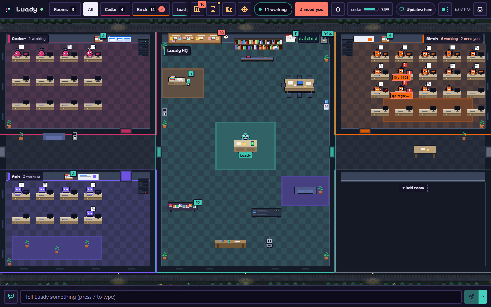
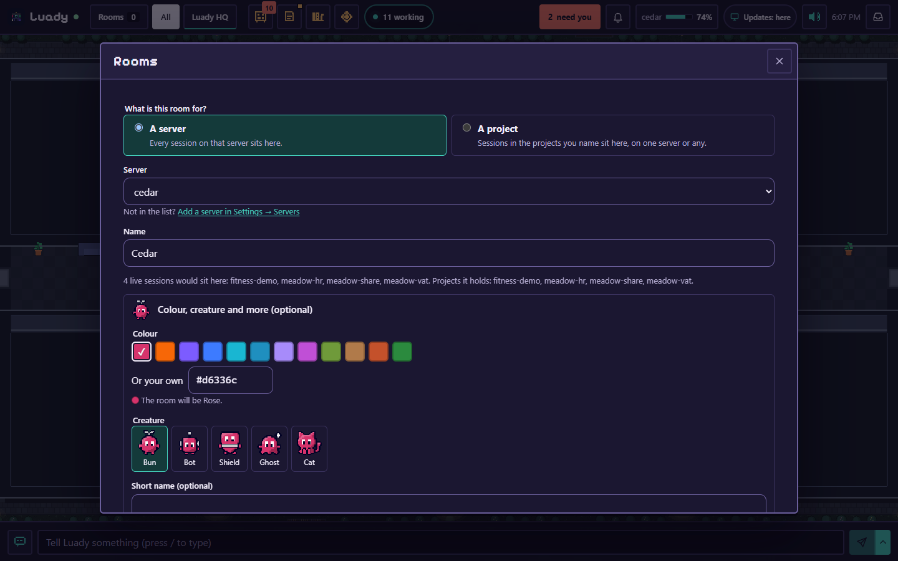
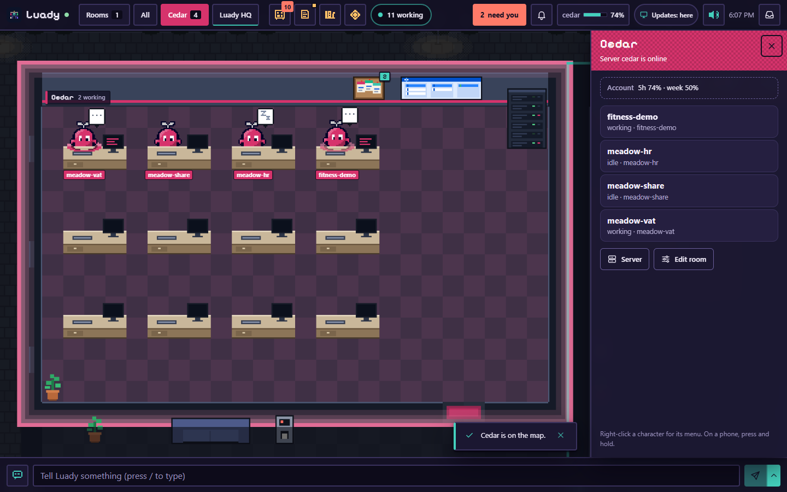
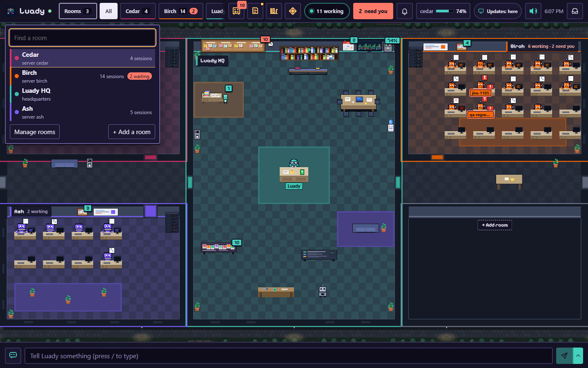

# Rooms

The office is a map of rooms around the manager's headquarters (HQ) in the middle. Each room holds the Claude Code
sessions of one server, of this computer, or of a set of projects. There is no set limit on the number of rooms: the map
grows in rings around HQ as you add them.

## Kinds of room

| Kind | Holds | Example |
|---|---|---|
| **A server** | Every session on that server. | A room for the server `cedar`. |
| **This computer** | Every session on the machine the hub runs on. | Your workstation. |
| **A project** | The sessions of the projects you name, on one server or on any. | `web-*` on every server. |

A server, and this computer, can each have one **home room**: the room for the machine itself. Project rooms come on top
of that, as many as you like.

## Add a room

There are three ways in:

- click **+ Add room** on a free spot of the map;
- open the **Rooms** menu at the top left and choose **+ Add a room**;
- open **Settings → Rooms** and choose **Add a room**, or **Create a room for each server** to add the missing ones at
  once.

> [!NOTE]
> **Settings** is a page of the Classic view: choose **Classic view** at the top right of the office, then
> **Settings**, or open <http://localhost:7410/settings>.

The editor asks what the room is for, which server, and a name. Before you save, it lists the live sessions that would
sit in the room. **Colour, creature and more** is optional:

- **Colour:** twelve ready colours, or your own. A colour too dark or too light is adjusted so the room stays readable,
  and the editor warns you when it is close to another room's colour or to one the office uses for alerts.
- **Creature:** bun, bot, shield, ghost or cat. Every session in the room is drawn as that creature, in the room's colour.
- **Short name:** shown on the room chips at the top; up to 12 characters.

When you save, the camera flies to the new room and opens its panel.

## Find a room

The chips at the top jump to a room; **All** shows the whole office. With many rooms, open the **Rooms** menu: it lists
every room with how many sessions it holds and lets you search by name, server or kind.

## Project rooms

A project room names the projects it holds, in up to eight rows (**Add a project**). Each row matches either:

- **Project name:** the project's name, such as `web-app`, or a pattern such as `web-*`;
- **Folder:** the session's working folder, such as `/home/dev/projects/web-app/**`.

In a pattern `*` stands for any run of characters and `?` for one character. In a folder pattern neither crosses a `/`,
and a trailing `/**` takes the folder and everything below it.

A server room can name projects too. Then the sessions of other projects on that server still sit there, but as
**guests**, so you can tell them apart.

## How a session finds its room

When a session appears, the office places it like this:

1. In the most specific project room that matches it, on its own server or on any server. A folder match beats a
   name match, then the longer fixed start of the pattern (the part before its first `*` or `?`) wins, then the room
   that comes first on the map.
2. Otherwise in the home room of its server (or of this computer), as a guest when that room names projects and none
   of them fits.
3. Otherwise, as a guest, in the first room of its server.
4. Otherwise it is not on the map. HQ's panel lists it under "Not on the map", and you still find it under **Sessions**
   in the Classic view.

## Work with sessions

- **Start one.** Open the **Library** in the office's tools, pick a project, choose **New session here**, give the
  session a name and, if you like, a first prompt, then press **Start session**. In the Classic view: **Sessions → New
  session**. The session runs in tmux on that project's machine, with permissions bypassed.
- **Look at one.** Click its creature: its panel shows its recent steps and its to-do list, and lets you send it a
  message or pause it.
- **Answer one.** When a session asks a question or wants permission for a tool, its bubble says it is waiting, and the
  red counter in the top bar (for example "2 need you") counts what waits for you. Press it to go to the next one; that
  session's panel shows the question and the buttons to answer it.

## Rename, recolour, reorder

Open a room's panel and choose **Edit room**, or use **Edit** in **Settings → Rooms**.

To reorder, go to **Settings → Rooms**. Drag a room onto another to put it in that spot (the rooms are then packed
together), or use **Move to…** to pick an exact spot. Spots are numbered from HQ outwards.

## Remove a room

Use the bin icon in **Settings → Rooms**. Removing a room never stops a session: its sessions move to another room of
their server, or to "Not on the map". The dialog asks what happens to the room's own things:

- **its links:** move them to another room, or delete them;
- **its Jira board:** move it to another room, or disconnect it (this asks for your PIN).

When you remove a server, you choose whether its rooms are kept (marked as removed, still editable) or deleted with
their links and Jira site. See [Remove a server](servers.md#remove-a-server).
