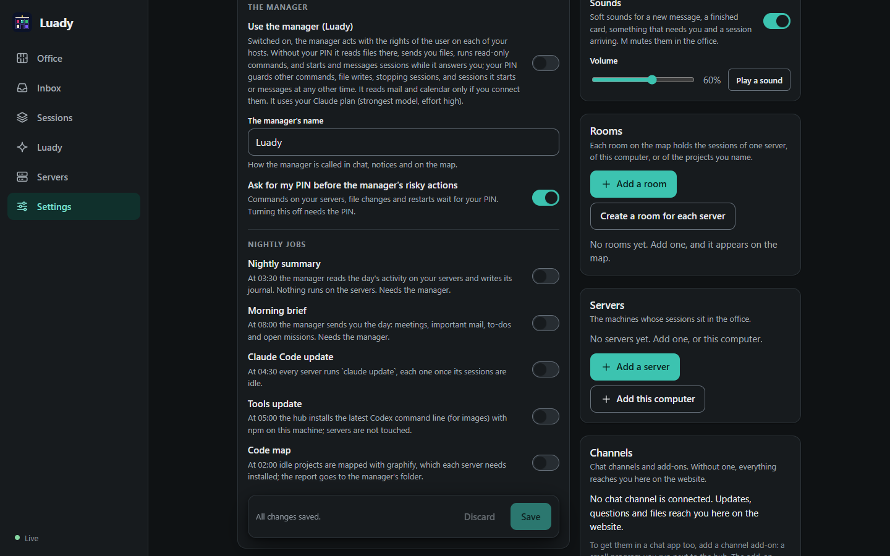
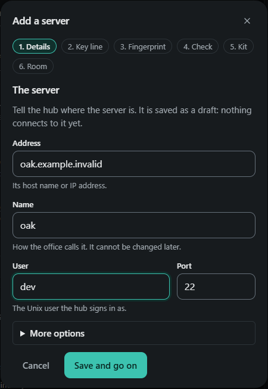
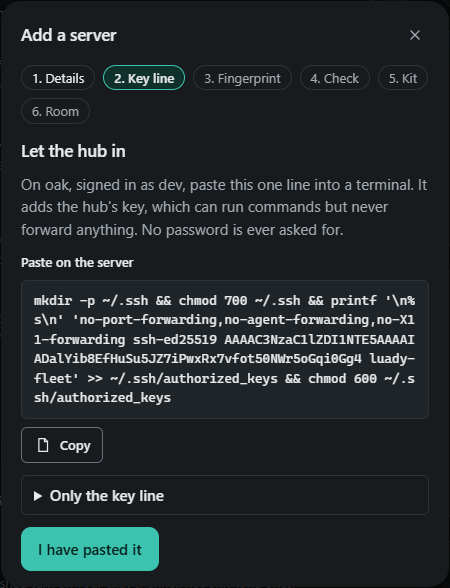

# Adding servers

Luady watches Claude Code sessions on two kinds of machine: **servers** it reaches over SSH, and **this computer**, the
machine the hub runs on. You add both from the website, in the setup wizard or later in **Settings → Servers**. No
file to edit and no script to run on the hub.

> [!NOTE]
> **Settings** is a page of the Classic view: choose **Classic view** at the top right of the office, then
> **Settings**, or open <http://localhost:7410/settings>.



## What a server needs

- Linux, reachable over SSH from the hub machine. The hub signs in with a key, never a password.
- A normal Unix user (not root) for the hub to sign in as, in lower case (for example `dev`). Claude Code runs as that
  user, and its sessions can do anything that user can.
- Python 3.10 or newer as `python3`, tmux, `tar`, `mktemp` and Claude Code. The check step looks for them before the kit
  installs, and lists what is missing.
- Sessions that run inside tmux. The kit finds every tmux pane that runs Claude Code. Sessions you start from the
  website are created in tmux for you.

## Add a server

**Settings → Servers → Add a server** opens a six-step dialog. The same dialog runs inside the setup wizard.



1. **Details.**
   - **Address**: the server's host name or IP address.
   - **Name** in the office: 2 to 24 lower-case letters, digits and dashes, starting with a letter and ending with a
     letter or digit. A few names are kept for the hub (such as `computer`, `hq` and `setup`). It cannot be changed
     later.
   - **User** and **port** for SSH.
   - **More options**: the projects folder (default `~/projects`) and the path to Claude Code (default
     `~/.local/bin/claude`).

   **Save and go on** asks for your PIN. The server is kept as a draft: nothing connects to it yet.
2. **Key line.** The hub shows one line to paste into a terminal on the server, signed in as that user. It adds the
   hub's public key to `~/.ssh/authorized_keys`, limited so it can run commands but never forward ports, agents or X11,
   and makes `~/.ssh` and the file owner-only. **Only the key line** shows just the key, if you would rather add it
   yourself. Press **I have pasted it** when it is done.

   

3. **Fingerprint.** Press **Test the connection**: the hub connects once to read the server's host key fingerprint. It
   does not sign in. Run the command it shows on the server (`ssh-keygen -lf` on the server's host key) and compare the
   two, character by character. Tick **It matches** only if they are the same; then **Trust this server**. If they
   differ, press **It does not match** and stop: you may not be talking to your server.
4. **Check.** Press **Check now**. The hub signs in and checks what the server has: Python, tmux, tar, mktemp, Claude
   Code, and whether a kit is already there. It may take up to 20 seconds. If the key is refused, the step shows the
   key line again.
5. **Kit.** You agree, and the hub installs the kit (see below). The dialog shows its progress and when it is done. New
   sessions on that server then appear in the office at once; sessions that were already running appear after the hub
   restarts.
6. **Room.** Name the server's room and pick its colour and creature. Sessions you start from then on appear in it.

The hub never trusts a host key on its own. If a server's key changes later, the hub stops connecting to it and the
server shows **Fingerprint changed**; see [Troubleshooting](troubleshooting.md#a-server-says-it-cannot-connect).

## Add this computer

**Settings → Servers → Add this computer** (the same button is in the wizard) is shorter: no key line and no
fingerprint. Choose the folder your projects are in (`~/projects` is suggested); tick **Create it if missing** (it is
ticked) and the hub makes it, inside your home folder only. Confirm with your PIN, then check, install the kit and add
the room. The button is there while this computer is not added.

This computer needs tmux, Python 3.10 or newer and Claude Code, like any server, and it must be Linux: the hub runs on
Linux or in WSL2.

## The servers list

**Settings → Servers** lists every server with its state (**Ready**, **Connected, no kit**, **Connecting**, **Offline**,
**Key refused**, **Fingerprint changed** or **Not confirmed yet**) and its kit version. Each row has the buttons that fit it:

- **Continue setup**, for a server whose steps above are not finished;
- **Check**, which signs in again and looks at what the server has;
- **Install kit**, **Update kit** and **Remove kit**;
- **Edit**, to change the address, user, port, projects folder or Claude Code path (this asks for your PIN). A new
  address, user or port means a new fingerprint check: the hub stops using the server until you confirm it again;
- **Remove**, see below.

## What the kit changes

The kit is a small Python program, standard library only. Installing it on a machine:

- copies the program to `~/.luady` in the user's home;
- adds the kit's hooks to Claude Code's `~/.claude/settings.json`, after any hooks already there, and keeps a backup of
  the file first;
- adds the kit's status line to Claude Code. An existing status line that is a command keeps showing.

It also writes three things you should know about, listed under [What a server keeps](#what-a-server-keeps): a copy
of the knowledge base, the files you send a session through the manager (`~/luady-inbox/`), and, if you switch on the
nightly **Code map**, a `graphify-out/` folder in each mapped project. Nothing else changes. The hooks report what each
session does, and forward questions and permission requests to you. What they send is short: step lines, the first 200
characters of each prompt, Claude's last message of a turn, errors, notifications, questions with their options, and
permission previews (a file change shows the lines it changes). They send no command output and no whole files, with
two exceptions: the preview of a new file (Write) carries its text, up to 8,192 characters, and Claude's last message
can quote output. Before any of it leaves the server, a redactor replaces common secret shapes (keys, tokens,
passwords in commands, URLs and headers) with `[redacted]`. It is a best effort, not a guarantee: a secret it does not
recognise goes out as it is, so keep secrets out of prompts. A request with a redacted or cut part (a command, a file
change, an MCP tool's input, which is shown whole as JSON), or a command that pushes part of itself out of view (three
blank lines in a row, 200 whitespace characters in a row, or an invisible format character), cannot be allowed from
the website or the chat; you deny it or answer it in the terminal. The chat also refuses a yes to any request it had
to cut to fit its 600 characters; you allow that one on the website, which shows it whole, or in the terminal.

The hub also reads from a server what you open, in full and not redacted: a session's transcript when you open the
session (Claude's work with its tool output and the file contents it read), its terminal screen, a file in the file
view, and the output of a command run there.

Removing the kit takes the hook entries out of `settings.json` (with a backup), puts the previous status line back and
deletes the kit's code. The `~/.luady` folder stays, with its state and a few stand-in files, so that a session that is
still running does not break.

## What a server keeps

- `~/.luady/`: the kit's code, its settings (`state/config.json`: the server's name in the office, its projects folder
  and Claude Code path), the event spool, pause flags, a trash folder for deleted sessions and the backups of
  `~/.claude/settings.json`. Also, while a question or permission request waits, its file in `pending/` with the full
  tool input (not redacted) and then its answer in `answers/`, both removed once it is settled; and in `registry/` one
  small file per session (its id, folder, transcript path and tmux pane).
- `~/luady-kb/`: the hub's copy of the knowledge-base pages, with `INDEX.md`. A new Claude Code session on that machine
  is told where it is. Only the server's user can read these files. See
  [The knowledge base and the code map](manager.md#the-knowledge-base-and-the-code-map).
- `~/luady-inbox/`: the files you send a session through the manager. Only the server's user can read them.
- With the nightly **Code map** on: a `graphify-out/` folder in each project it maps, listed in that project's
  `.git/info/exclude`.

Removing the kit leaves `~/luady-kb/` and `~/luady-inbox/` where they are, and `~/.luady/` as described above. Delete both by hand once no
session runs.

## What the hub runs on a server

The commands the hub builds itself over SSH are a fixed list: the kit's `luady-ctl` verbs, and three fixed scripts for
setup (the check, the kit install, the removal of its key line). Text never becomes part of a command line; it goes in
on standard input. A shell command that you or the manager type reaches a server in three ways only. The **terminal**
you open yourself asks for your PIN. A command you run from the website, and one the manager runs (both the kit's `exec`
verb), ask for it too, unless the hub judges the command to be read-only; on this computer every command asks. All three
stop asking if you turn off **Ask for my PIN before the manager's risky actions** in **Settings → General** (see
[The manager](manager.md#with-your-pin)); turning it off needs the PIN.

Reading and writing a file on a server (the website's file view, the manager's file tools) goes through the kit, which
refuses a short list of paths, also through a symlink or `..`: SSH keys (`~/.ssh`), the kit's waiting questions and
answers (`~/.luady/pending`, `~/.luady/answers`), writes to the kit's settings (`~/.luady/state/config.json`), the
hub's own folders (`luady` under `~/.config`, `~/.local/share` and `~/.local/state`, and under `$XDG_CONFIG_HOME`,
`$XDG_DATA_HOME` and `$XDG_STATE_HOME` when they are set), the sign-in files of Claude Code and common tools
(`~/.claude/.credentials.json`, `~/.claude.json`, `~/.aws/credentials`, `~/.git-credentials`, `~/.netrc`, `~/.npmrc`,
`~/.docker/config.json`, `~/.kube/config`, `~/.config/gh/hosts.yml`), process environments (`/proc/*/environ`),
`/etc/shadow` and `/etc/sudoers`. This is a short deny list, not a boundary: every other file the server's user can
read or write is in reach, and a shell command reaches these too.

> [!WARNING]
> The sessions themselves are Claude Code with permissions bypassed: they can do anything their Unix user can on that
> server. See [Security](security.md).

## Remove a server

In **Settings → Servers**, choose **Remove** and confirm with your PIN. You decide:

- whether to uninstall the kit (ticked by default);
- whether to remove the hub's key line from `~/.ssh/authorized_keys` (ticked by default). If the server cannot be
  reached, the dialog shows a command to run on it yourself;
- whether its rooms are kept (marked as removed, still editable) or deleted with their links and Jira site.

**This computer** has the same **Remove** in **Settings → Servers**; it has no key line to remove.

The history of its sessions stays. A removed server's name is never reused; add it again under a new name.

## Servers from the config file

You can also list servers in `~/.config/luady/config.json` under `servers`: each has a `name`, `host`, `user`, `port`
and the host key's fingerprint as `hostKeyFp` (`SHA256:…`, as `ssh-keygen -lf` prints it), and may have `projectsRoot`
and `claudeBin`. A key the hub does not know stops it from starting. Such servers show **from config.json** in the list
and cannot be edited or removed on the website, though you can check them and install or remove their kit. To change one
(a new fingerprint, say) or to remove it, edit the file and restart the hub. All keys are listed in
[The config file](configuration.md).

## The fleet key

The hub signs in to every server with one ed25519 key, made on its first start and kept in its data folder
(`~/.local/share/luady/data/fleet_ed25519`, mode 0600). Its key line starts with the options
`no-port-forwarding,no-agent-forwarding,no-X11-forwarding`, and adds `from="…"` when you set `fleetFrom` in
`config.json`. To replace the key:

1. Stop the hub (`systemctl --user stop luady.service`, or <kbd>Ctrl</kbd>+<kbd>C</kbd>).
2. Move the key aside:

   ```sh
   cd ~/.local/share/luady/data
   mv fleet_ed25519 fleet_ed25519.old
   mv fleet_ed25519.pub fleet_ed25519.pub.old
   ```

3. Start the hub (`npm start`, or `systemctl --user start luady.service`). It makes a new key.
4. In **Settings → Servers**, press **Check** on each server. The server refuses the new key, and the check then shows
   the new key line (for a server that is already set up, the line appears only after such a check). Add it to
   `~/.ssh/authorized_keys` on that server and press **Try again**.
5. Remove the old line from each server's `authorized_keys`: the other line that ends in `luady-fleet`, not the one you
   just added.
6. When every check passes, delete the `.old` files.

Replacing the key from the website is not in this version.
