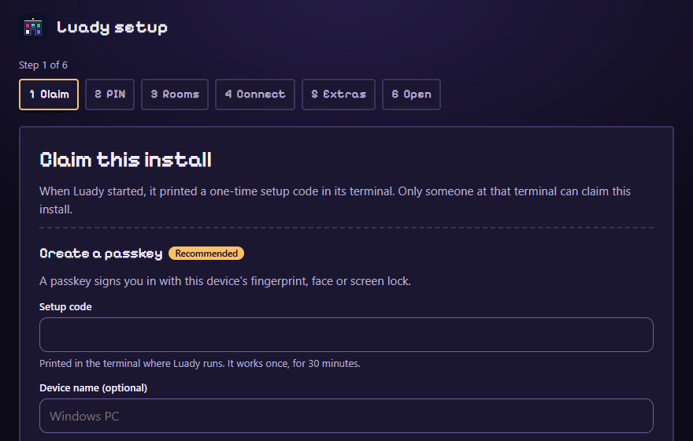
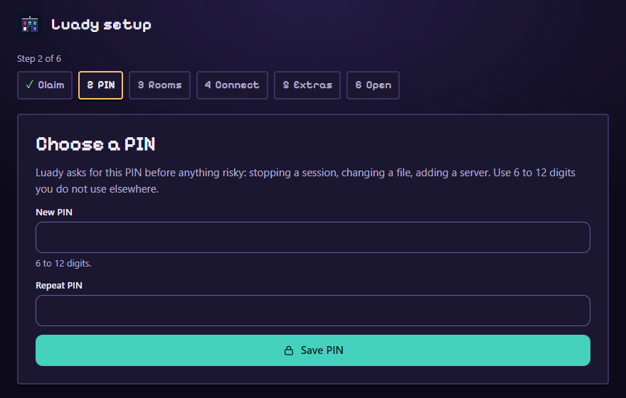
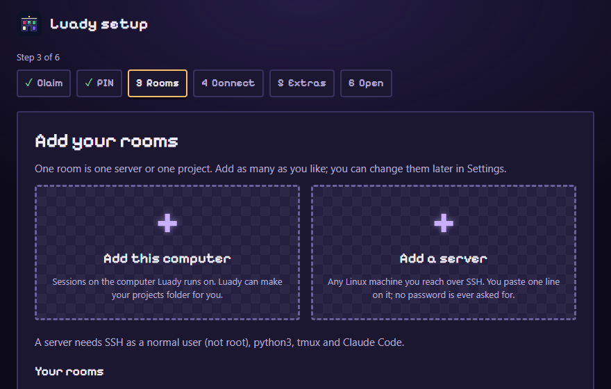
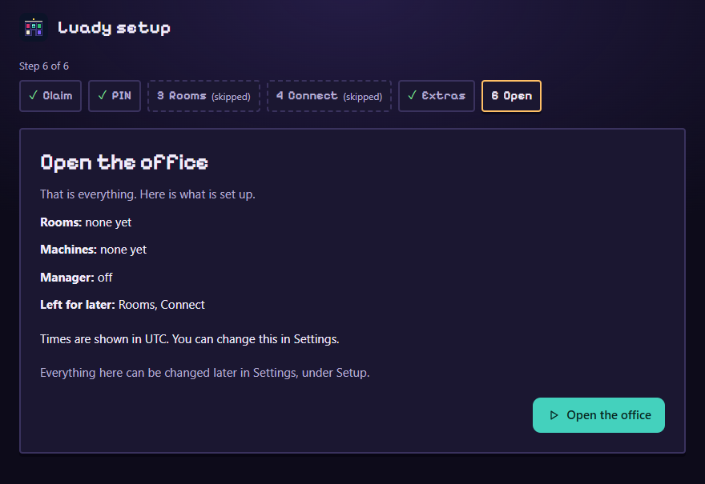

# The setup wizard

A new hub opens the setup wizard the first time you visit it. It walks through six steps:

```text
claim  ->  PIN  ->  rooms  ->  connect  ->  extras  ->  open
```

The page lists the steps and says "Step 3 of 6" and so on. You can skip the rooms, connect and extras steps (**Skip for
now**) and come back to them later. After the last step the wizard closes for good, and `/setup` takes you to the
office. Once you have a PIN and until the wizard is finished, Luady's other pages lead back to it.

## Before you start

Start the hub with `npm start` (see [Getting started](getting-started.md#install-and-start)). On a hub nobody has
claimed yet, the terminal prints a **setup code** (a hub started by systemd prints none, since its output goes to the
journal: print one as below). It works for 30 minutes and is used up when you set your PIN. Only one code works at a
time: a new one ends the one before it. New codes come from `npm run luady -- setup-code`, from `npm run luady -- login`
while no PIN is set, and from each start in a terminal of a hub nobody has claimed yet. If it runs out, print a new one:

```sh
npm run luady -- setup-code
```

Then open <http://localhost:7410> on the hub machine.

## 1. Claim the hub

Claiming makes you the owner. Type the setup code, then create a **passkey** on this device (your fingerprint, face,
screen lock or security key). The passkey is how you sign in from then on. The same code is good for the PIN in the next
step, as long as it has not run out.



No passkey on this device? On an install that is not remote (see [What "remote" means](security-notes.md#what-remote-means)),
you can sign in with a login link instead:

```sh
npm run luady -- login
```

It prints a link that works once, for 5 minutes, from a browser on the hub machine, or at the other end of an SSH tunnel
to it. While no PIN is set it also prints a new setup code, which you need for the PIN. After the link signs you in, the
wizard offers to add a passkey, or to **Skip for now**. Without a passkey you sign in with `npm run luady -- login` each
time. A login link on its own never claims the hub: it stays unclaimed until the first PIN is set, and that needs the
setup code. A passkey is the better choice, and the hub requires one before you make it a remote install; an SSH tunnel
needs none.

## 2. Choose a PIN

The PIN is 6 to 12 digits. The hub asks for it before risky actions, such as stopping a session, adding or removing a
server, writing a file on a server or opening a terminal. Starting a session and sending it a message need no PIN. The
first PIN needs the setup code as well.



Three wrong tries in a row lock the PIN for 15 minutes; each new lock lasts twice as long. Forgot it? Run
`npm run luady -- pin reset` on the hub machine (see [Troubleshooting](troubleshooting.md#i-forgot-my-pin)).
Later, change the PIN in **Settings → Security**; that needs the current one.

## 3. Rooms

Here the office gets its first rooms. **Add this computer** and **Add a server** each add a machine and a room for it.



- **Add this computer.** For the Claude Code sessions on the machine the hub runs on. Pick the folder your projects are
  in (`~/projects` is suggested). Tick **Create it if missing** and the hub makes it, inside your home folder only. It
  asks for your PIN.
- **Add a server.** For a Linux server you reach over SSH. The wizard runs the [add-a-server flow](servers.md#add-a-server):
  details, a key line to paste on the server, a fingerprint check, a connection check, the kit (a small Python program
  the hub installs) and the room. A server needs SSH as a normal user (not root), Python 3.10 or newer, tmux, tar, mktemp
  and Claude Code.
- **Your rooms.** **Create a room for each server** makes a room for every machine that has none. The list below adds,
  edits and removes rooms one by one, including project rooms (a room for a set of projects instead of a whole
  machine). See [Rooms](rooms.md#project-rooms). **Next** goes on; while there is no room it says **Skip for now**.

You can add more rooms any time, from the map, the **Rooms** menu or **Settings → Rooms**.

## 4. Connect

This step lists your machines. For each one you can **install the kit** (see
[What the kit changes](servers.md#what-the-kit-changes)) and, once the kit is there, **sign in to Claude** on it, from
the website. It also reminds you that sessions Luady starts run with permissions bypassed.

## 5. Extras

Optional things, all off until you switch them on:

- **The manager.** The switch is off. Next to it the wizard says in plain words what the manager may touch. Switching it
  on offers the manager its own Claude sign-in. See [The manager](manager.md).
- **Nightly jobs**, all off on a new hub. Switch them on here, or later in **Settings → General**:
  - **Nightly summary** and **Morning brief**: written by the manager, so they need it.
  - **Claude Code update**: at 04:30 every server runs `claude update`, once its sessions are idle.
  - **Tools update**: at 05:00 the hub machine installs the newest Codex CLI (`@openai/codex`, used by the manager's
    picture tool) from the npm registry.
  - **Code map**: idle projects on your servers are mapped with `graphify`, which Luady does not install (it must be
    at `~/.local/bin/graphify` on each server). Each mapped project gets a `graphify-out/` folder.
- **Chat channels.** None is built in; a channel comes as an [add-on](addons.md).
- **Optional modules**, such as Google, Wispr, mail over IMAP and Jira, each with a line on how to connect it.

### Connecting the optional modules

- **Google** (mail and calendar for the manager): create an OAuth web client in your Google account with
  `http://localhost:7410/api/google/callback` as its redirect address, put `GOOGLE_CLIENT_ID` and
  `GOOGLE_CLIENT_SECRET` in `~/.config/luady/secrets.env`, restart the hub, then press **Connect**.
- **A mailbox over IMAP**: put `IMAP_HOST`, `IMAP_USER` (the address), `IMAP_PASSWORD` and, if needed, `IMAP_PORT`
  (default 993) and `IMAP_LABEL` in `secrets.env`, then restart the hub.
- **Wispr Flow** (meeting notes): press **Connect** and approve it on Wispr Flow.
- **Jira**: connect it from a room's Jira panel in the office.

## 6. Open the office

The last screen sums up what is set up (rooms, machines, the manager, what you left for later). **Open the office**
closes the wizard. Sessions you start on a machine with the kit installed appear at a desk in their room.



Luady uses your time zone for the nightly jobs and the times it shows. When you choose your PIN, the hub keeps your
browser's zone (unless one is already set), and the summary says which zone that is; change it in
**Settings → General**. While none is set, the website uses your browser's zone and the hub UTC.

## Starting again

The wizard runs once per hub. To change what the wizard set up, use **Settings → Setup**: it opens the rooms, connect
and extras steps again, and rooms, servers, channels, the manager and security each have a section there.

> [!NOTE]
> **Settings** is a page of the Classic view: choose **Classic view** at the top right of the office, then
> **Settings**, or open <http://localhost:7410/settings>.

## Next

- [Rooms](rooms.md): arrange the office.
- [Adding servers](servers.md): more servers, and what the hub does on them.
